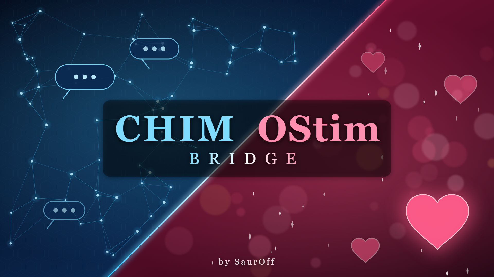

# CHIM OStim Bridge

A Skyrim SE/AE mod by **SaurOff** that connects [CHIM](https://www.nexusmods.com/skyrimspecialedition/mods/126330)
(AI-driven NPCs) with [OStim Standalone](https://www.nexusmods.com/skyrimspecialedition/mods/98163).
CHIM AI agents can start, change and end OStim scenes on their own - with the player,
with other NPCs or in groups - choosing the kind of scene from the conversation. They
also react to the world, talk about a scene after it ends, and can have simple needs
configured in the MCM.

> **Adult content.** This mod deals with sexual content in a video game and is meant
> for adults only.

This repository is the complete source of the mod. Players should download the packaged
release (FOMOD archive) from the **[Nexus Mods page](https://www.nexusmods.com/skyrimspecialedition/mods/194761)**
instead of building it.

- **[BUILDING.md](BUILDING.md)** - how to build the release from these sources, step by
  step, and where every file in the release comes from
- **[DEPENDENCIES.md](DEPENDENCIES.md)** - every requirement and what it is used for
- [docs/README.txt](docs/README.txt) - the player readme shipped in the archive
- [docs/CHANGELOG.txt](docs/CHANGELOG.txt)

## What it does

- **AI actions** added to CHIM's action list: `Start_Intimate_Scene`,
  `Change_Intimate_Scene`, `Stop_Intimate_Scene`, `Undress`, `Get_Dressed`,
  `Feed_On_Blood` (vampires). Every result is reported back to the AI, so a refusal
  ("weapons are still drawn") is answered in character.
- **Scene logic**: partners and groups by name, the act or position taken from what
  was said, men in the active role (optional), partners brought together, a missionary
  or any scene as fallback.
- **Reactions** the AI comments on: cities, shops, the player's home, waking up,
  dragon souls, undressing, scenes nearby, and the scene that just ended.
- **Needs** for NPCs named in the MCM: hunger for sex, blood thirst (game vampires by
  default), drinking, arousal, jealousy.
- **Two CHIM fixes**: "speech only" (no third-person self-narration) and replies being
  aborted after a long session.
- **MCM** through MCM Helper, translated into 12 languages with English fallback.

## How it works

```
          Skyrim (game)                                    CHIM server (WSL, HerikaServer)
 +-------------------------------+                 +------------------------------------------+
 | CHIMOStimBridge.esp (ESL)     |                 | ext/cob_ostim_bridge/                     |
 |  COB_Bridge  <----------------+-- CHIM_Command  |  functions.php   actions for the LLM,     |
 |   runs actions via OStim,     |   Received      |                  installed into           |
 |   reports results ------------+---------------->|                  core_action_custom      |
 |  COB_Events                   |   funcret       |  prompts.php     cues for the events      |
 |   OStim events, locations,    |                 |  preprocessing   silent state, CHIM fix   |
 |   needs, MCM settings --------+---------------->|  context_pre     needs + rules appended   |
 |  COB_MCM (MCM Helper)         |  cob_* events   |                  to every prompt          |
 +-------------------------------+                 |  cob_lib.php     shared code, state in    |
   Data/CHIM/server-plugins/                       |                  conf_opts                |
   cob_ostim_bridge/<ver>.dwpkg ---- installed ---->+------------------------------------------+
                                     by CHIM at game start
```

1. The LLM picks one of the bridge's actions while replying. CHIM sends it to the game
   as the mod event `CHIM_CommandReceived` (`ExtCmdCOB_StartScene`, ...).
2. `COB_Bridge` resolves the people involved, sorts roles, finds a matching OStim scene
   and starts it, then reports the outcome back to CHIM (`funcret`).
3. `COB_Events` tells CHIM about things worth commenting on (`cob_city`, `cob_after`, ...)
   and sends silent state (`cob_state`: scenes, orgasms, settings) that the server stores
   without showing it to the AI.
4. The server plugin turns that state into a few lines at the end of each prompt
   (needs, the "speech only" rule, "agreeing to a scene means starting it").

The server half ships inside the game mod as a `.dwpkg` package, which CHIM's game
plugin uploads to its own server at game start - players never copy server files by hand.

## Repository layout

```
src/Scripts/Source/   Papyrus sources: COB_Bridge, COB_Events, COB_MCM, COB_Config
server/
  cob_ostim_bridge/   CHIM server plugin (PHP) - packaged into the .dwpkg
  *.bat, *.ps1        optional manual install / uninstall of the server plugin
mcm/                  MCM Helper menu (config.json, settings.ini) and translations/
fomod/                FOMOD installer (info.xml, ModuleConfig.xml)
docs/                 player README, CHANGELOG, Nexus page texts
art/                  banner generator and the banner
stubs/                declaration-only Papyrus files for the compiler (not shipped)
make_esp.py           writes the plugin CHIMOStimBridge.esp
compile_scripts.ps1   compiles the Papyrus scripts
localize.py           MCM string table and translation file generator
build.py              builds the .dwpkg and the FOMOD release zip
verify_release.py     checks the release zip against the sources
```

## Building

Short version (details, requirements and options in [BUILDING.md](BUILDING.md)):

```
python3 -I make_esp.py
powershell -ExecutionPolicy Bypass -File compile_scripts.ps1 -Compiler "<Papyrus Compiler folder>" -GameData "<Skyrim>\Data"
python3 -I build.py
python3 -I verify_release.py "release/CHIM OStim Bridge.zip"
```

## Installing (players)

Requirements: SKSE64, Address Library, CHIM (plugin and server), OStim Standalone,
PapyrusUtil, SkyUI, MCM Helper - see [DEPENDENCIES.md](DEPENDENCIES.md).
Install the [release archive](https://www.nexusmods.com/skyrimspecialedition/mods/194761?tab=files)
with Vortex or MO2, start the CHIM server, then the game.
More in [docs/README.txt](docs/README.txt).

## License

The mod's own code and files are released under the [MIT License](LICENSE).
The files in `stubs/` only declare the public script APIs of Bethesda, SkyUI and
MCM Helper for the compiler; they are not covered by this license and are not shipped.
CHIM, OStim Standalone and the other requirements belong to their authors and are not
included here.

## Credits

Dwemer Dynamics for CHIM, the OStim team for OStim Standalone, exiledviper and meh321
for PapyrusUtil, the SkyUI team, Exit-9B for MCM Helper, the SKSE team.
