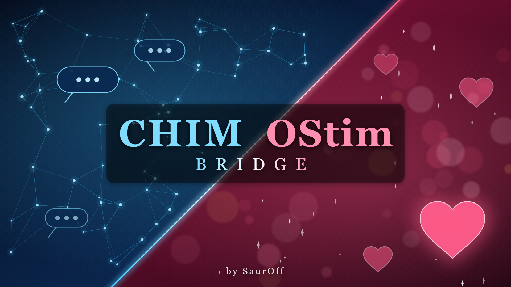

# CHIM OStim Bridge

A Skyrim SE/AE mod by **SaurOff** that connects [CHIM](https://www.nexusmods.com/skyrimspecialedition/mods/126330)
(AI-driven NPCs) with [OStim Standalone](https://www.nexusmods.com/skyrimspecialedition/mods/98163).
CHIM AI agents can start, change and end OStim scenes on their own - with the player,
with other NPCs or in groups - choosing the kind of scene from the conversation. They
also react to the world, talk about a scene after it ends, and can have simple needs
configured in the MCM.

> **Adult content.** This mod deals with sexual content in a video game and is meant
> for adults only.

> **Since 2.0 the vampire features are no longer part of this mod.** Blood thirst, the bite
> and Vampire Lords (1.1) moved, together with the thralls made for 1.2, to a mod of their own:
> **[CHIM Vampire Bridge](https://www.nexusmods.com/skyrimspecialedition/mods/198441)** ([GitHub](https://github.com/SimpleL97/CHIM-Vampire-Bridge)).
> It takes over the bitten, turned and thrall NPCs of an existing save, the server state
> and the actions by itself - install it when updating from 1.x to keep them.

This repository is the complete source of the mod. Players should download the packaged
release (FOMOD archive) from the **[Nexus Mods page](https://www.nexusmods.com/skyrimspecialedition/mods/194761)**
instead of building it.

- **[BUILDING.md](BUILDING.md)** - how to build the release from these sources, step by
  step, and where every file in the release comes from
- **[DEPENDENCIES.md](DEPENDENCIES.md)** - every requirement and what it is used for
- [docs/README.txt](docs/README.txt) - the player readme shipped in the archive
- [docs/CHANGELOG.txt](docs/CHANGELOG.txt)

## What it does

**AI actions** added to CHIM's action list (each can be switched off there):

| Action | What the agent does |
|---|---|
| `Start_Intimate_Scene` | starts an OStim scene with the player, another NPC or a group. The kind comes from the conversation: oral, cunnilingus, vaginal, anal, handjob, boobjob, kissing, sixtynine, cowgirl, reverse cowgirl, doggystyle, missionary, masturbation. Masturbation without a partner is a solo scene while the others watch. |
| `Change_Intimate_Scene` | switches the running scene to another act or position |
| `Stop_Intimate_Scene` | ends the scene |
| `Undress` / `Get_Dressed` | takes clothes off without a scene and later puts exactly those back on |

Every result is reported back to the AI, so a refusal ("weapons are still drawn", "she is
not here") is answered at once and in character.

**Scene logic**
- No name: the agent and the player. One name: the agent and that person. Two or more
  names: exactly those people, so an agent can arrange a scene for others and watch.
- Any nearby NPC can be named, not only CHIM agents. Partners up to 50 m away (MCM) are
  brought together.
- Men take the active role (optional).
- If the asked act is not installed, the mod falls back to a missionary scene, then to any
  scene. A group with no fitting animation falls back to its two main people.
- When the people involved agree on a scene in conversation, the agent starts it without
  a separate order.

**Reactions** the AI comments on (MCM toggles, chance, cooldown):
- the big cities, shops and your home;
- waking up, dragon souls, you undressing;
- a scene starting nearby;
- the talk after a scene: who came and how it ended. An agent who took part in the scene
  is the one who talks about it.

Your own scenes are always talked about, other people's at a limited rate, so an inn full
of scenes from other mods does not hold up the replies.

**During scenes** (MCM page OStim addons)
- **Talking:** a short line when the position changes and when an agent climaxes.
- **Cries of passion** (off by default): short cries in the agent's own voice, more often
  as OStim excitement climbs.
  - The phases: a teasing murmur at the start, moans, begging near the peak, a cry at
    climax, then a contented sigh or a soft laugh.
  - Alone in a scene (masturbation), only wordless moans.
  - With Inworld TTS each phase gets its tone (breathless, ecstasy, orgasming, pleading,
    satisfied...) and a faster delivery. The tone is only in the voice, never in the
    subtitles or the history.
  - MCM: the pause between cries, the speed, and an option for women only.

**What other OStim mods know reaches the agents.** Each has its own switch; none is
required, and each is only read when installed:
- OVirginity: a virgin knows it, and a lost virginity is part of the scene's reaction;
- OCum: where the cum landed;
- OISeeYouMasturbating: whether she let you watch;
- OMerchants and OTrainers: a discount or a lesson paid with the scene;
- Morning Sex and the like: a scene right after waking up is a morning one.

**Needs** for the NPCs named in the MCM:
- hunger for sex: restless, then burning, then angry;
- drinking: tipsy, then drunk, wearing off with game time;
- arousal during and right after a scene;
- jealousy between the companions you list.

**CHIM fixes** (MCM)
- "Speech only": no third-person self-narration read out by the voice, cut out even when
  it slips into a reply.
- Replies are no longer aborted after a long session.

**Also:** notifications and a log file in the game and on the CHIM server, and an MCM
through MCM Helper in 12 languages with English fallback.

## My CHIM mods

| Mod | What it adds | Get it |
|---|---|---|
| **CHIM OStim Bridge** (this one) | AI agents start, change and end OStim scenes; reactions, talk and cries of passion during scenes; needs | [Nexus](https://www.nexusmods.com/skyrimspecialedition/mods/194761) · [GitHub](https://github.com/SimpleL97/CHIM-OStim-Bridge) |
| **CHIM ORomance Bridge** | love, partners and marriage (several spouses) through ORomance Plus, married life, children with Fertility Mode | [Nexus](https://www.nexusmods.com/skyrimspecialedition/mods/198436) · [GitHub](https://github.com/SimpleL97/CHIM-ORomance-Bridge) |
| **CHIM Vampire Bridge** | vampires: blood thirst, the bite, Vampire Lords, thralls who obey; the vampire features of this mod's 1.x | [Nexus](https://www.nexusmods.com/skyrimspecialedition/mods/198441) · [GitHub](https://github.com/SimpleL97/CHIM-Vampire-Bridge) |
| **CHIM Travel Fix** | Travel_To goes to the place the agent named, in any game language, not a random one | [Nexus](https://www.nexusmods.com/skyrimspecialedition/mods/198442) · [GitHub](https://github.com/SimpleL97/CHIM-Travel-Fix) |

Each works on its own, and none needs another. Installed together, they see each other:
- a thrall of CHIM Vampire Bridge can be undressed and brought into scenes here by name,
  even one who is not an AI agent;
- spouses of CHIM ORomance Bridge who ask for the marital duty start their scene here;
- what happens in one mod (a scene, a wedding, a pregnancy, a thrall) reaches every AI
  agent nearby.

In the game they share only a StorageUtil list (`COV_Thralls`). On the server, each plugin
reads another one's settings only when that plugin is installed and switched on.

## Supported mods

| Mod | | |
|---|---|---|
| [CHIM](https://www.nexusmods.com/skyrimspecialedition/mods/126330) | required | plugin and server; tested with 3.4.2 |
| [OStim Standalone](https://www.nexusmods.com/skyrimspecialedition/mods/98163) | required | 7.3.1+, tested with 7.5.1 |
| [PapyrusUtil SE/AE](https://www.nexusmods.com/skyrimspecialedition/mods/13048), [SkyUI](https://www.nexusmods.com/skyrimspecialedition/mods/12604), [MCM Helper](https://www.nexusmods.com/skyrimspecialedition/mods/53000), [Address Library](https://www.nexusmods.com/skyrimspecialedition/mods/32444) | required | |
| [OVirginity Reflowered](https://www.nexusmods.com/skyrimspecialedition/mods/77929) | optional | virgins, a lost virginity |
| [OCum Ascended](https://www.nexusmods.com/skyrimspecialedition/mods/77506) | optional | where the cum landed |
| [OISeeYouMasturbating](https://www.nexusmods.com/skyrimspecialedition/mods/142008) | optional | whether she let you watch |
| [OMerchants](https://www.nexusmods.com/skyrimspecialedition/mods/101831), [OTrainers](https://www.nexusmods.com/skyrimspecialedition/mods/101830) | optional | a discount or a lesson paid with the scene |
| [Morning Sex](https://www.nexusmods.com/skyrimspecialedition/mods/98054) | optional | morning scenes |
| OStim packs with 3+ actor scenes, e.g. [Billyy MFF Pack](https://www.nexusmods.com/skyrimspecialedition/mods/106582) | optional | group scenes |
| Inworld TTS (in CHIM) | optional | the tone of the cries of passion |

## How it works

```
          Skyrim (game)                                    CHIM server (WSL, HerikaServer)
 +-------------------------------+                 +------------------------------------------+
 | CHIMOStimBridge.esp (ESL)     |                 | ext/cob_ostim_bridge/                     |
 |  COB_Bridge  <----------------+-- ExtCmdCOB_*   |  functions.php   actions for the LLM,     |
 |   runs actions via OStim,     |   (via COB)     |                  installed into           |
 |   reports results ------------+---------------->|                  core_action_custom      |
 |  COB_Events                   |   funcret       |  prompts.php     cues for the events      |
 |   OStim events, locations,    |                 |  preprocessing   silent state, CHIM fix   |
 |   needs, MCM settings --------+---------------->|  context_pre     needs + rules appended   |
 |  COB_MCM (MCM Helper)         |  cob_* events   |                  to every prompt          |
 +-------------------------------+                 |  cob_lib.php     shared code, state in    |
   Data/CHIM/server-plugins/                       |                  conf_opts                |
   cob_ostim_bridge/<ver>.dwpkg ---- installed ---->+------------------------------------------+
                                     by CHIM at game start
```

1. The LLM picks one of the bridge's actions while replying (`ExtCmdCOB_StartScene`, ...).
   CHIM's game plugin hands it to the global function `COB.DispatchExternalCommand`, the
   entry point it looks for first; `COB` forwards it to `COB_Bridge` as the mod event
   `COB_Command`. (CHIM's fallback mod event `CHIM_CommandReceived` is heard too.)
2. `COB_Bridge` resolves the people involved, sorts roles, finds a matching OStim scene
   and starts it, then reports the outcome back to CHIM (`funcret`, through
   `AIAgentFunctions.logMessageForActor`, addressed to the agent).
3. `COB_Events` tells CHIM about things worth commenting on (`cob_city`, `cob_after`, ...)
   and sends silent state (`cob_state`: scenes, orgasms, settings) that the server stores
   without showing it to the AI.
4. The server plugin turns that state into a few lines at the end of each prompt
   (needs, the "speech only" rule, "agreeing to a scene means starting it").

The server half ships inside the game mod as a `.dwpkg` package, which CHIM's game
plugin uploads to its own server at game start - players never copy server files by hand.

## Repository layout

```
src/Scripts/Source/   Papyrus sources: COB (CHIM entry point), COB_Bridge, COB_Events, COB_MCM, COB_Config
server/
  cob_ostim_bridge/   CHIM server plugin (PHP) - packaged into the .dwpkg
  *.bat, *.ps1        optional manual install / uninstall of the server plugin
mcm/                  MCM Helper menu (config.json, settings.ini) and translations/
fomod/                FOMOD installer (info.xml, ModuleConfig.xml)
docs/                 player README, CHANGELOG, Nexus page texts
art/                  banner generator and the banner
stubs/                declaration-only Papyrus files for the compiler (not shipped)
make_esp.py           writes the plugin CHIMOStimBridge.esp
compile_scripts.ps1   compiles the Papyrus scripts
localize.py           MCM string table and translation file generator
build.py              builds the .dwpkg and the FOMOD release zip
verify_release.py     checks the release zip against the sources
```

## Building

Short version (details, requirements and options in [BUILDING.md](BUILDING.md)):

```
python3 -I make_esp.py
powershell -ExecutionPolicy Bypass -File compile_scripts.ps1 -Compiler "<Papyrus Compiler folder>" -GameData "<Skyrim>\Data"
python3 -I build.py
python3 -I verify_release.py "release/CHIM OStim Bridge.zip"
```

## Installing (players)

Requirements: SKSE64, Address Library, CHIM (plugin and server), OStim Standalone,
PapyrusUtil, SkyUI, MCM Helper - see [DEPENDENCIES.md](DEPENDENCIES.md).
Install the [release archive](https://www.nexusmods.com/skyrimspecialedition/mods/194761?tab=files)
with Vortex or MO2, start the CHIM server, then the game.
More in [docs/README.txt](docs/README.txt).

## License

The mod's own code and files are released under the [MIT License](LICENSE).
The files in `stubs/` only declare the public script APIs of Bethesda, SkyUI and
MCM Helper for the compiler; they are not covered by this license and are not shipped.
CHIM, OStim Standalone and the other requirements belong to their authors and are not
included here.

## Credits

Dwemer Dynamics for CHIM, the OStim team for OStim Standalone, exiledviper and meh321
for PapyrusUtil, the SkyUI team, Exit-9B for MCM Helper, the SKSE team.
